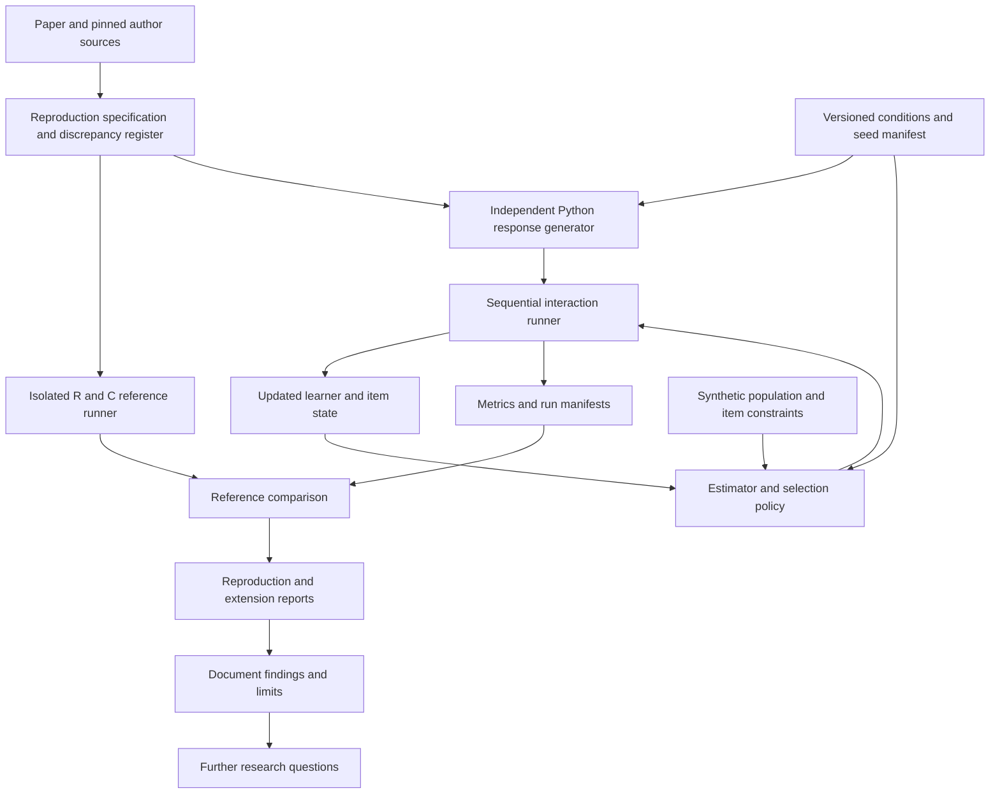

# Simulation reproduction and adaptive learning research plan

Reproduce the measurement results in _Keeping Elo alive_, then investigate
rating systems and item selection under realistic synthetic learning conditions.
The output is a reproducible research package describing where each method
works, where it fails and which conclusions depend on modeling assumptions.
Successful simulation does not establish a learning benefit in real learners.

**Revision:** 0.2, 11 October 2026. **Status:** proposed research program;
implementation and simulation results are not yet available.

## Research questions and boundaries

1. Can an independent implementation reproduce published behavior and numerical
   summaries within declared Monte Carlo uncertainty?
2. How do estimation and selection methods compare with limited response budgets?
3. How robust are candidate policies to sparse evidence, learning, forgetting,
   imperfect difficulty estimates and exhausted fresh content?
4. Which conclusions transfer across response and learning models, and which
   require empirical learner evaluation?

All experiments use synthetic learners and item banks. Item content, identities
and software from private applications are outside the research inputs. The
[source register](source-register.md) records the public sources used to define
the reproduction. Extension configurations specify their assumptions separately
from the published conditions.

## Proposed architecture



Use Python with NumPy, SciPy, Matplotlib and pytest; lock the selected Python
version and dependencies during stage 1. Add a compiled numerical kernel only
if profiling justifies it and parity tests pass. R and a C compiler support
the reference runner. Record the required toolchain in setup documentation.
Rebuild upstream C from source in an isolated environment rather than loading
the repository's precompiled binaries. Pin its dependencies and record any
platform adaptations.

Proposed repository structure:

```text
src/adaptive_learning_lab/
  models/          Hidden abilities, response models, learning and forgetting
  estimators/      Standard Elo, parallel Elo and Urnings
  policies/        Item eligibility, selection rules and comparison policies
  simulation/      Event order, independent streams, checkpointing and recovery
  metrics/         Scale alignment, estimation and selection outcomes
configs/
  paper/           Published conditions and source compatibility profiles
  extensions/      Extension conditions and explicit assumptions
tests/
  fixtures/        Tiny numerical traces and synthetic content contracts
reference/         Upstream manifest, build instructions and recorded patches
reports/           Retained reports and compact evidence
outputs/           Ignored run outputs and resumable checkpoints
docs/              Plan, source register and reviewed decisions
```

These folders are proposed; create them when their implementation begins.
Separate the hidden response generator from the estimator so later experiments
can deliberately violate the estimator's assumptions. Never feed true ability
or true difficulty into an ordinary selector; oracle selection is a named
diagnostic control only.

## Stage 1 establish the specification and numerical harness

First freeze a crosswalk from each published figure and supplementary result to
its condition, source script, metric, run length and reference output. Use the
final paper's figure numbers; the upstream README has older numbering. Retrieve
the supplement and OSF results where available, recording hashes and reuse
terms. OSF and the supplement could not be fetched during planning; their
availability must not be assumed.

Inspect upstream execution order, parameter initialization, random streams,
scale centering, variance denominators and averaging windows. Record differences
between article and source as separate profiles. A source defect is not an
instruction to duplicate that defect silently. The source register identifies
an apparent loop-initialization issue requiring investigation before reference
MSE results are used. Preserve original source and any documented patch.

Build a small independent reference implementation before optimizing. Verify:

- Stable logistic probabilities, normalized adaptive selection probabilities
  and a defined error when there is no eligible item.
- Correct signs for ability and difficulty updates; fixed difficulties remain
  fixed; a shared location shift leaves response probabilities unchanged.
- Parallel Elo has separate learner **and** item state in both chains. Selection
  uses the opposite chain, only the active chain learns from that response, and
  learner-specific response parity is retained across interruptions.
- Scripted tiny traces reproduce hand calculations and audited upstream
  transitions, including Urnings boundary and acceptance behavior.
- Chunking and resume preserve the independent implementation's output under
  the same recorded environment. Changed configurations cannot resume an old run.

Use a proposed absolute tolerance of `1e-10` for finite deterministic state
comparisons. Different languages need not produce identical random draws from
the same integer seed: use explicit random inputs for trace comparisons and
statistical comparisons for independently generated runs.

**Acceptance:** reviewed condition/figure crosswalk, a discrepancy register with
dispositions, passing deterministic tests and a measured runtime/storage pilot.
Unresolved reference access can permit algorithm development but keeps affected
figure-reproduction claims open.

## Stage 2 reproduce the paper

Published setup: stable Rasch responses; fixed versus updated item difficulties
crossed with random versus adaptive selection. Start with the published baseline,
then vary one factor at a time. Parallel Elo addresses variance inflation in
the updated/adaptive condition but does not remove all bias.
[Paper](https://bpspsychub.onlinelibrary.wiley.com/doi/10.1111/bmsp.12395).

The following executable settings are supported by the pinned author files
listed in the [source register](source-register.md#author-implementation).

| Setting                      | Reproduction specification                                                                                                                                  |
| ---------------------------- | ----------------------------------------------------------------------------------------------------------------------------------------------------------- |
| Population and bank          | 1,000 learners; 200 items                                                                                                                                   |
| Standard run                 | 1,000 responses per learner; 500 independent system replications                                                                                            |
| True parameters              | Equally spaced normal quantiles at `j/(n+1)`; learner SD 1, item mean 0 and SD 1.5; preserve the source's learner permutation                               |
| Population mean              | `logit(0.7)` for random conditions; `logit(p)` in the adaptive sweep                                                                                        |
| Initialization               | Learners at the population mean; updated items at zero; fixed items at their true difficulties                                                              |
| Selection kernel             | Normal density of estimated ability minus estimated difficulty, centered at `logit(p)`, SD 0.5                                                              |
| Step size sweep              | `K = 0.1, 0.2, 0.3, 0.4, 0.5`; baseline 0.3                                                                                                                 |
| Adaptive target sweep        | `p = 0.5, 0.6, 0.7, 0.8, 0.9`; baseline 0.7                                                                                                                 |
| Parallel run lengths         | For the K sweep: 2,000 / 1,300 / 1,100 / 1,000 / 1,000 response pairs; for the p sweep: 1,000 / 1,000 / 1,100 / 1,100 / 1,600 pairs                         |
| Higher replication baselines | Separate source profile with 10,000 replications; parallel baseline has 1,100 pairs                                                                         |
| Urnings comparison           | Baseline target 0.7; urn size 32; 2,200 responses; initial learner/item counts 22/16; include acceptance correction and selection smoothing from the source |

Deduplicating shared baselines gives 28 standard conditions and nine parallel
conditions, plus the Urnings comparison. This is not the full K-by-p Cartesian
grid. Treat 10,000-replication baseline runs, auxiliary diagnostics and
supplementary runs as additional profiles in the crosswalk, not hidden additions
to the 500-replication budget.

Report learner and item trajectories; bias and absolute bias; variance across
replications; spread across learners/items; mean squared error; and hitting time.
The source's hitting time uses the first approach within 0.01 of the final
500-timepoint mean. Distinguish that statistic from reaching the true value or
remaining stable. Convert parallel pairs to actual responses. Keep chain-wise
results and averaged-chain results separate.

Match the source's identification and aggregation operations for reproduction.
Also provide clearly labeled per-replication centered errors for extensions;
centering after aggregation can change variance interpretation. Never interpret
cross-learner spread as estimator uncertainty. Nonconvergent conditions get drift
results and a nonconvergence flag, not an invented invariant mean or hitting time.

Reproduce the oracle-selection and selected-error diagnostics and lagged-rating
autocorrelations where they support the published explanation. Urnings comparisons
must match the source's probability/logit transformations and reliability
definition. A naive second Elo chain or an uncorrected urn update is not a valid
substitute.

**Acceptance:** a figure-by-figure table reporting reproduced, discrepant or
unavailable; audited numerical comparisons; correctly labeled response counts;
and the expected stable/drifting patterns under the published conditions.
Before the full run, freeze numerical equivalence margins: proposed 0.02 logits
for mean absolute bias, 0.02 logit-squared for variance, and the larger of 10
responses or 10% for mean hitting time. These are lab acceptance proposals, not
the authors' criteria. For machine-readable references, require a 95% interval
for the difference within each margin. Account for reference uncertainty when
known; insufficient precision is inconclusive. Plot-only references support
coarser visual checks and cannot establish numerical equivalence. Report every
planned comparison and investigate failed margins without widening them after
seeing results. Freeze final margins in stage 1 before confirmation runs.

## Stage 3 compare methods under extended conditions

Treat all values below as synthetic sensitivity settings, not measured learner
parameters. Start with one-factor screens, then investigate consequential
interactions using separate confirmation seeds. Hold the underlying population
fixed when comparing target probabilities in these extensions.

Compare the following policies at equal response budgets and under the same
eligibility constraints:

1. A fixed curriculum that cycles through concepts using a predeclared item order.
2. A simple difficulty staircase with promotion and demotion thresholds defined
   in configuration before evaluation.
3. Standard Elo with fixed difficulties; standard Elo with updated difficulties;
   and parallel Elo with updated difficulties.
4. Urnings for comparable conditions, following stage 2 validation.
5. Random eligible selection as a diagnostic control, and true-parameter
   selection as an explicitly labeled upper-information reference.

Compare all policies on selection and outcome metrics. Compare parameter
estimation only among methods that produce comparable estimates. Ordinal item
labels are not calibrated logits: vary the mapping and its error explicitly.

| Experiment                         | Proposed conditions                                                                                                                                           | Research purpose                                                                         |
| ---------------------------------- | ------------------------------------------------------------------------------------------------------------------------------------------------------------- | ---------------------------------------------------------------------------------------- |
| Short sessions and sparse evidence | Session lengths of 5 / 10 / 20 responses; evaluate after 5, 10, 20, 50, 100 and 200 cumulative responses                                                      | Measure selection quality and the cost of splitting observations between parallel chains |
| Population and content scarcity    | Cohorts of 25 / 100 / 1,000; 1 / 3 / 6 eligible items per difficulty band per concept; absent bands and complete exhaustion                                   | Establish calibration requirements and behavior when candidate items run out             |
| New learners and new items         | Entry at the start and midway; 0 / 10 / 50 prior item responses; difficulty initialization error with SD 0 / 0.5 / 1 logit                                    | Measure cold-start performance and recovery from incorrect priors                        |
| Multiple concepts                  | 1 / 5 / 20 concepts; mixed ability profiles; single-skill and mixed-skill items                                                                               | Compare global and per-concept ratings and detect concealed weaknesses                   |
| Changing knowledge and recency     | No change; gradual gains totaling 0.5 / 1 logit per 20 responses; sudden 1-logit changes; return gaps of 1 / 7 / 30 days with varied decay                    | Measure tracking lag and sensitivity to stale observations                               |
| Guessing and model mismatch        | Guess probabilities 0 / 0.1 / 0.25; slip probabilities 0 / 0.1 / 0.2; item discrimination 0.5 / 1 / 2; separate binary and multiple-answer scoring conditions | Test departures from Rasch and response-format assumptions                               |
| Dependence and feedback            | Repeated items, related item families, responses following explanations and held-out outcome items                                                            | Identify inflated evidence from repeated exposure or assistance                          |
| Event order and interrupted runs   | Uneven activity, interrupted sessions, duplicate events, missing history and revised item banks                                                               | Test sensitivity to scheduling and verify deterministic recovery                         |

Apply a separate step-size sensitivity screen: constant K, decreasing K and
separate learner/item K. These are extensions, never substitutes in the paper
reproduction. Compare noisy fixed difficulties with the idealized true-fixed
control.

Prioritize limited response budgets, scarcity and cold starts. Dynamic and
multidimensional experiments follow validated baselines. Do not expand every
setting into one unmanageable Cartesian grid.

Primary measures include held-out response prediction error where predictions
exist, distance from the configured challenge target, concept coverage,
exhaustion/repetition rates and responses needed for useful stable estimates.
Include bias/RMSE by ability and item exposure, exposure concentration, tracking
lag, latency and memory. Each uncertainty interval must identify its estimand;
correlation between chains is not an individual learner's confidence interval.

**Correctness requirements:** held-out outcome items never enter practice;
duplicate events never create extra updates; the configured response budget is
respected; checkpoints reproduce the uninterrupted run; and empty eligibility
sets produce an explicit stop or defined fallback. Report low-ability and
sparse-history groups separately so aggregate results cannot conceal failures.

**Acceptance:** a comparison report with predeclared practical effect margins,
uncertainty estimates, computational costs and sensitivity to assumptions. Prefer
simple explanations for comparable performance. Inconclusive differences and
conditions favoring different methods are valid research outcomes.

## Stage 4 investigate learning and forgetting

Measurement quality and learning outcomes need separate experiments. First use
exogenous ability trajectories to measure tracking without claiming that item
selection caused learning. Then use explicitly hypothetical, policy-dependent
learning/forgetting mechanisms to test the robustness of apparent advantages.
Include multiple plausible mechanisms, varying benefit from challenge, feedback,
prerequisites and spacing; include settings with no policy benefit.

Compare held-out unseen performance after synthetic 7- and 30-day delays at
equal study time, and time to a predeclared unseen-performance criterion. Model
question, explanation and review time explicitly; a fixed time per answer is
only one sensitivity case. Report all assumptions and mechanisms under which
the conclusion reverses. These experiments do not establish real retention,
causal learning gains or assessment validity in human populations.

Deliver a research report with estimator/policy versions, input contracts,
computational requirements, failure cases and limitations. Provide small,
language-neutral numerical fixtures so other implementations can check their
calculations. Describe the empirical evidence that would be needed to test
external validity; recruiting participants or collecting real learner data is
outside the simulation program.

**Acceptance:** reproducible outputs, an answer or explicit unresolved finding
for each research question, and documented sensitivity to the learning model.
A correct simulator can be accepted while a learning hypothesis remains
unproven.

## Execution and reproducibility

Use independent system replications as the uncertainty unit. Learners share item
ratings, so treating every answer as independent would understate uncertainty.
Use paired system seeds across policies for matched exogenous conditions, with
separate streams for population, arrivals, response noise, selection and learning.
Policies that choose different items need an explicit keyed response-noise
scheme or independent streams, not accidental alignment of one mutable RNG.

Use independent training/tuning and confirmation seeds. Choose extension
replication counts from a pilot and a frozen precision target for primary
contrasts. Label exploratory analyses; use simultaneous intervals or a
predeclared multiplicity procedure for multiple primary comparisons. Do not
tune a policy on the same runs used to claim improvement.

Each run manifest records the lab commit and dirty-state patch hash, upstream
revision, input/configuration hashes, seeds and stream scheme, dependency lock,
hardware/compiler, timestamps, event count, resource use and output checksums.
Retain configuration and compact per-replication summaries; full answer traces
are reserved for tiny debugging runs. A checkpoint contains state and all RNG
positions. Resume only with matching hashes; preserve failed runs with the
failure reason. Plots and tables must regenerate from retained outputs.

| Run profile            | Purpose and proposed limit                                                                                                                                                  |
| ---------------------- | --------------------------------------------------------------------------------------------------------------------------------------------------------------------------- |
| Smoke                  | Tiny traces and at most 2 million responses; development/CI target below five minutes                                                                                       |
| Pilot                  | One reduced condition per family, up to 30 minutes per batch; estimate scaling and storage                                                                                  |
| Paper                  | Exact counts after the pilot; at most four local workers, eight hours per resumable batch, eight hours aggregate worker CPU time per batch and 20 GB retained local outputs |
| Source figure baseline | Separate 10,000-replication profile, subject to the same batch/resource limits and checkpointing                                                                            |
| Extensions             | Screen then confirm; reuse summaries and stay within the configured resource budget                                                                                         |

These are ceilings, not runtime promises. Standard paper conditions contain
`1,000 × 1,000 × 500 = 500 million` responses each; 28 unique conditions mean
14 billion responses before parallel Elo and auxiliary runs. Adaptive item
selection also evaluates candidate items. Benchmark that work before estimating
completion dates. Never quietly shrink a run and label it full reproduction.
The proposed initial campaign limit is **40 aggregate worker CPU hours**, with
wall time also reported. If the full work will exceed it, present the measured
remaining cost and revise the execution plan before continuing. Paid/cloud
computation is outside the initial local execution profile.

Source audit or hard correctness failure stops the affected experiment, while
independent experiments may continue. Inconclusive precision or unavailable
reference data is reported explicitly; it does not become a passing result.

## Milestones and recovery

| Milestone | Deliverable                       | Completion evidence                                                            |
| --------- | --------------------------------- | ------------------------------------------------------------------------------ |
| M0        | Research specification            | Plan, public source register and experiment definitions                        |
| M1        | Audited specification and harness | Figure crosswalk, discrepancy dispositions, trace tests and resource pilot     |
| M2        | Paper reproduction                | Condition manifests, numerical comparisons, figures and unresolved differences |
| M3        | Extension experiments             | Comparator fixtures, eligibility checks and exploratory/confirmation reports   |
| M4        | Research synthesis                | Learning-model sensitivity, reproducible report and further research questions |

M0 documents are available as proposals. M1–M4 have not been implemented or run.
Estimate execution time after M1's runtime pilot. Review each milestone against
its acceptance criteria and revise the plan explicitly when methods or scope
change.

Recovery means stop the batch, retain its manifest/logs, restore the last
verified checkpoint or rerun from a recorded seed. Never overwrite accepted
results with a rerun; issue a new run ID and mark the predecessor superseded.
Keep code and configuration in version control.

Before publishing software or results, verify reproducibility, dependency and
source notices, data inclusion and the exact release contents. Exclude secrets,
local filesystem paths and private project references from repository files and
output metadata. Preserve methodological provenance using public source
identifiers and checksums. Report completed checks and unresolved limitations
with each release.

## Evidence status

The paper and pinned public author source have been inspected. Reference-data
availability and the source discrepancies in the
[source register](source-register.md) remain open. No algorithm implementation,
simulation execution or reproduced result is claimed by this plan.
